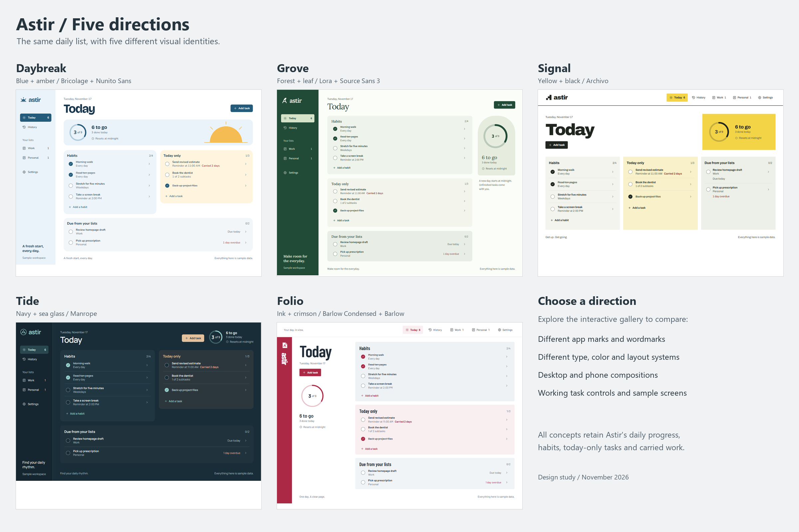

# Astir design exploration

The owner selected **Signal** on November 17, 2026. The production design and its five palettes are documented in [the current design guide](../../DESIGN.md). The gallery below preserves the original comparison.

Five independent visual directions for the working Today view. The review gallery includes functioning sample checkboxes, progress totals, task details, task/habit creation, named lists, History and Settings. Data stays in memory, resets on reload, and never contacts Astir's API.

From the repository root:

```powershell
python -m http.server 4175 --bind 127.0.0.1 --directory docs/design-exploration
```

Open [the gallery](http://127.0.0.1:4175/). Choose a direction across the top. Changes to sample tasks carry across the directions, and **Reset sample** restores the original nine items. Resize the browser to compare the phone compositions.

| Direction | Character | Desktop | Phone | Logo |
| --- | --- | --- | --- | --- |
| [Daybreak](http://127.0.0.1:4175/?concept=daybreak) | Blue, amber, generous and friendly | [1440px](previews/daybreak-1440.png) | [390px](previews/daybreak-390.png) | [SVG](logos/daybreak.svg) |
| [Grove](http://127.0.0.1:4175/?concept=grove) | Green, journal-like and personal | [1440px](previews/grove-1440.png) | [390px](previews/grove-390.png) | [SVG](logos/grove.svg) |
| [Signal](http://127.0.0.1:4175/?concept=signal) | Yellow, graphic and direct | [1440px](previews/signal-1440.png) | [390px](previews/signal-390.png) | [SVG](logos/signal.svg) |
| [Tide](http://127.0.0.1:4175/?concept=tide) | Dark navy, sea glass and warm sand | [1440px](previews/tide-1440.png) | [390px](previews/tide-390.png) | [SVG](logos/tide.svg) |
| [Folio](http://127.0.0.1:4175/?concept=folio) | White, crimson and calendar-inspired | [1440px](previews/folio-1440.png) | [390px](previews/folio-390.png) | [SVG](logos/folio.svg) |



[DESIGN.md](DESIGN.md) records palettes, type choices and compositions. [REVIEW.md](REVIEW.md) records checks and remaining limits. This folder is separate from the Vite application and does not alter the shipped UI, data model, spec decisions, or release notes.

## Fonts and marks

The eight font families are bundled under `fonts/`, with their respective SIL Open Font License files. Source: the [`google/fonts` repository](https://github.com/google/fonts/tree/main/ofl): `archivo`, `barlow`, `barlowcondensed`, `bricolagegrotesque`, `lora`, `manrope`, `nunitosans`, and `sourcesans3`. Only upright weights are used in this study. The five app marks are original SVG sketches for this exploration; they are identity concepts rather than finalized or trademark-cleared logos.
